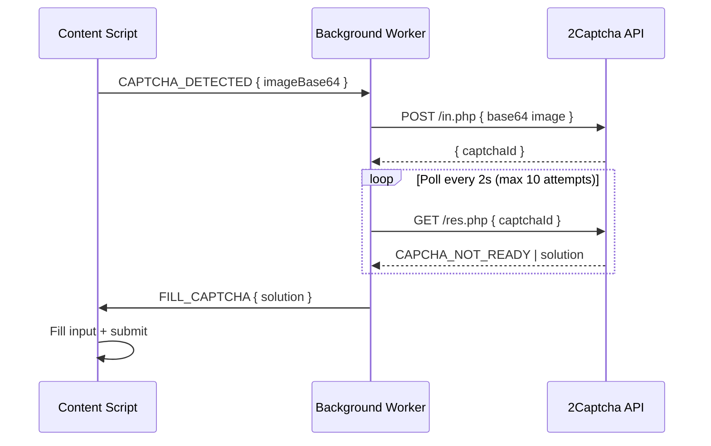

# 2Captcha Integration Contract

**Feature**: 001-tatkal-booking-assistant
**Date**: 2026-05-27

## Overview

The extension integrates with 2Captcha's HTTP API to solve IRCTC image CAPTCHAs automatically.

## API Endpoints

### Submit CAPTCHA for Solving

**Endpoint**: `POST https://2captcha.com/in.php`

**Request** (multipart/form-data or JSON):
```
key=<API_KEY>
method=base64
body=<BASE64_IMAGE>
json=1
```

**Response** (success):
```json
{ "status": 1, "request": "<CAPTCHA_ID>" }
```

**Response** (error):
```json
{ "status": 0, "request": "ERROR_WRONG_USER_KEY" }
```

### Retrieve Solution

**Endpoint**: `GET https://2captcha.com/res.php`

**Parameters**:
```
key=<API_KEY>
action=get
id=<CAPTCHA_ID>
json=1
```

**Response** (solved):
```json
{ "status": 1, "request": "<CAPTCHA_TEXT>" }
```

**Response** (not ready):
```json
{ "status": 0, "request": "CAPCHA_NOT_READY" }
```

## Integration Flow



## Error Handling

| Error Code | Meaning | Action |
|------------|---------|--------|
| ERROR_WRONG_USER_KEY | Invalid API key | Alert user to fix config |
| ERROR_KEY_DOES_NOT_EXIST | API key not found | Alert user to fix config |
| ERROR_ZERO_BALANCE | No funds in 2Captcha account | Alert user to top up |
| ERROR_NO_SLOT_AVAILABLE | All workers busy | Retry after 5 seconds |
| CAPCHA_NOT_READY | Still solving | Continue polling |
| ERROR_CAPTCHA_UNSOLVABLE | Workers couldn't solve | Refresh CAPTCHA on page, resubmit |

## Timeout Policy

- Max wait: 20 seconds (10 polls × 2 seconds)
- If timeout reached: refresh CAPTCHA on IRCTC page and resubmit to 2Captcha
- Max CAPTCHA attempts per session: 5 (then alert user)
