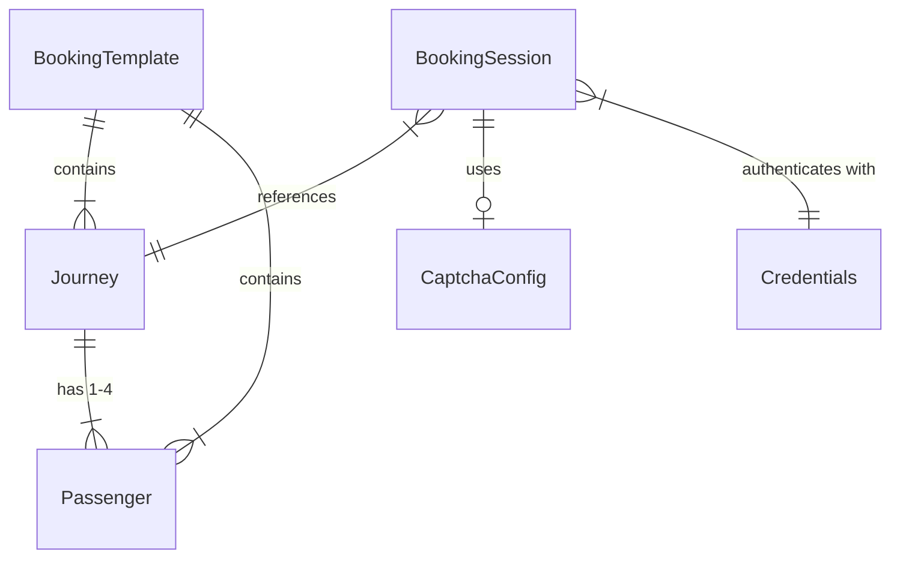

# Data Model: Tatkal Booking Assistant

**Feature**: 001-tatkal-booking-assistant
**Date**: 2026-05-27

## Entities

### Journey

Represents a planned train journey for Tatkal booking.

| Field | Type | Constraints | Description |
|-------|------|-------------|-------------|
| id | string (UUID) | required, unique | Unique journey identifier |
| sourceStation | string | required, IRCTC station code format (e.g., "NDLS") | Departure station |
| destinationStation | string | required, IRCTC station code format | Arrival station |
| journeyDate | string (YYYY-MM-DD) | required, must be future date | Date of travel |
| trainNumber | string | required, 5-digit format | Preferred train number |
| trainName | string | optional | Human-readable train name |
| classType | enum | required: "2A", "3A", "SL", "CC", "EC" | Booking class |
| quotaType | enum | required: "TQ" (Tatkal), "PT" (Premium Tatkal) | Tatkal quota type |
| tatkalType | enum | required: "AC" (10:00 AM), "NON_AC" (11:00 AM) | Determines trigger time |
| boardingStation | string | optional, station code | If different from source |
| createdAt | string (ISO 8601) | auto-generated | Creation timestamp |

**Validation Rules**:
- `sourceStation` ≠ `destinationStation`
- `journeyDate` must be exactly 1 day ahead (Tatkal allows booking one day in advance only)
- `trainNumber` must be a valid 5-digit Indian Railways train number
- `classType` must be compatible with `tatkalType` (AC classes for AC Tatkal, SL for Non-AC)

---

### Passenger

A traveler associated with a journey booking.

| Field | Type | Constraints | Description |
|-------|------|-------------|-------------|
| id | string (UUID) | required, unique | Unique passenger identifier |
| name | string | required, max 16 chars, uppercase | Full name as per ID proof |
| age | number | required, 5-125 | Passenger age |
| gender | enum | required: "M", "F", "T" | Gender |
| berthPreference | enum | optional: "LB", "MB", "UB", "SL", "SU", "NONE" | Berth preference |
| idType | enum | required: "AADHAAR", "PAN", "PASSPORT", "VOTER_ID", "DRIVING_LICENSE" | ID proof type |
| idNumber | string | required, format varies by type | ID proof number |
| nationality | enum | default: "IN" | Country code |
| foodChoice | enum | optional: "VEG", "NON_VEG", "NO_FOOD" | Food preference (if applicable) |

**Validation Rules**:
- `name` must contain only alphabets and spaces, IRCTC format (uppercase)
- Max 4 passengers per Tatkal ticket (IRCTC rule)
- At least one passenger required
- `idNumber` format validated per `idType` (e.g., Aadhaar = 12 digits)
- Children under 5 don't need a separate berth

---

### BookingSession

Tracks an active booking attempt from trigger to completion.

| Field | Type | Constraints | Description |
|-------|------|-------------|-------------|
| id | string (UUID) | required, unique | Session identifier |
| journeyId | string | required, FK → Journey | Associated journey |
| status | enum | required | Current session state (see state machine) |
| currentStep | enum | required | Active step in booking flow |
| retryCount | number | default: 0 | Total retries this session |
| captchaSolveCount | number | default: 0 | CAPTCHAs solved this session |
| startedAt | string (ISO 8601) | auto-set on trigger | When booking was triggered |
| completedAt | string (ISO 8601) | nullable | When session ended |
| pnrNumber | string | nullable | PNR if booking confirmed |
| errorLog | string[] | default: [] | List of errors encountered |

**State Machine** (`status`):
```
IDLE → LOGGING_IN → LOGGED_IN → SEARCHING → SELECTING_TRAIN →
FILLING_PASSENGERS → SOLVING_CAPTCHA → SUBMITTING → PAYING → CONFIRMED
                                                              ↓
                                                           FAILED
```

**`currentStep` values**: `LOGIN`, `SEARCH`, `TRAIN_SELECT`, `PASSENGER_FORM`, `CAPTCHA`, `REVIEW`, `PAYMENT`, `CONFIRMATION`

---

### Credentials (encrypted)

Stored IRCTC login credentials.

| Field | Type | Constraints | Description |
|-------|------|-------------|-------------|
| encryptedUsername | string | required | AES-GCM encrypted username |
| encryptedPassword | string | required | AES-GCM encrypted password |
| salt | string (base64) | required | PBKDF2 salt |
| iv | string (base64) | required | AES-GCM initialization vector |
| iterations | number | default: 100000 | PBKDF2 iteration count |

---

### CaptchaConfig

Configuration for the CAPTCHA solving service.

| Field | Type | Constraints | Description |
|-------|------|-------------|-------------|
| serviceProvider | enum | required: "2CAPTCHA", "ANTI_CAPTCHA" | Service to use |
| apiKey | string | required, encrypted | Service API key |
| maxWaitTime | number | default: 20000 | Max ms to wait for solution |
| pollInterval | number | default: 2000 | Ms between result polls |

---

### BookingTemplate

Reusable saved configuration for frequent bookings.

| Field | Type | Constraints | Description |
|-------|------|-------------|-------------|
| id | string (UUID) | required, unique | Template identifier |
| name | string | required | User-friendly template name |
| journey | Journey | required (embedded) | Journey details |
| passengers | Passenger[] | required, 1-4 items | Passenger list |
| createdAt | string (ISO 8601) | auto-generated | Creation timestamp |
| lastUsedAt | string (ISO 8601) | nullable | Last time this template was used |

## Relationships



## Storage Layout (chrome.storage.local)

```json
{
  "credentials": { "encryptedUsername": "...", "encryptedPassword": "...", "salt": "...", "iv": "..." },
  "captchaConfig": { "serviceProvider": "2CAPTCHA", "apiKey": "encrypted...", ... },
  "templates": [ { "id": "...", "name": "Delhi to Patna", "journey": {...}, "passengers": [...] } ],
  "activeSession": { "id": "...", "status": "IDLE", ... },
  "ntpOffset": 0,
  "settings": { "masterPasswordHash": "...", "autoLoginTime": "09:59:50" }
}
```
